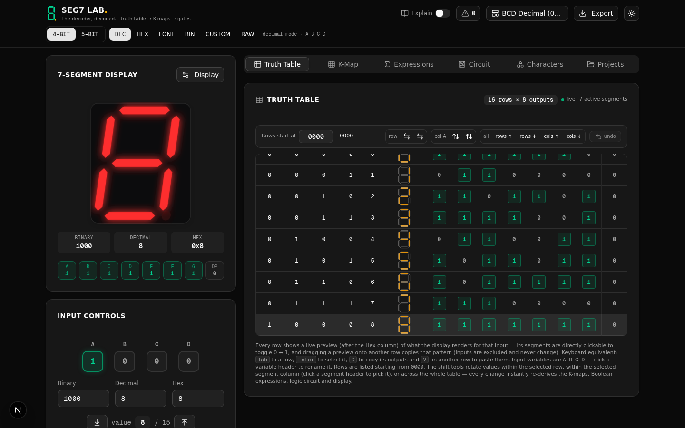
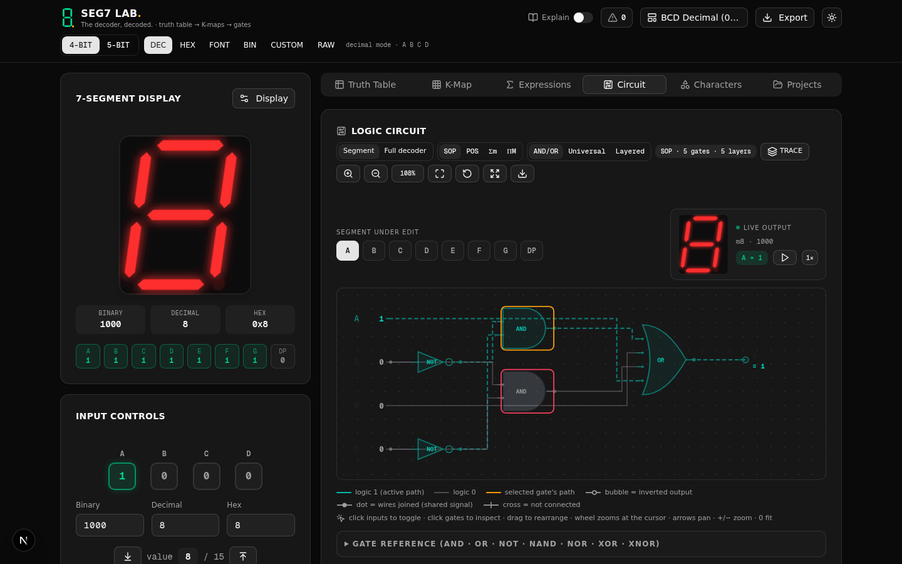
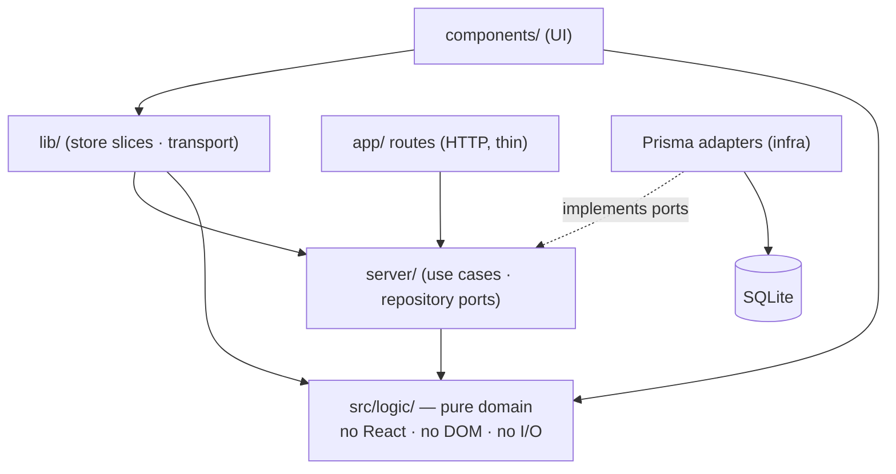

<div align="center">


# SEG7 Lab

**The decoder, decoded.**

An interactive **7-segment display decoder design lab.** One truth table is the single
source of truth; every other view — K-map, Boolean expressions, gate schematic, display
glyph, every export — is derived from it by pure functions, so no two views can ever
disagree.

[](https://github.com/mlger/seg7lab/actions/workflows/ci.yml)
[](https://seg7.mlger.dev)
[](./LICENSE)
[](https://nextjs.org)
[](https://react.dev)
[](https://www.typescriptlang.org)
[](https://bun.sh)

[Live demo](https://seg7.mlger.dev) · [Architecture](./docs/ARCHITECTURE.md) · [PRD](./PRD.md) · [Guide for coding agents](./AGENTS.md)

</div>

---



> One truth table. Everything else — K-map, Boolean expressions, gate schematic, display
> glyph, every export — is **derived** from it by pure functions, re-computed on every
> edit. If the table changes, no view can lag behind or disagree.

## ✨ What it does

| Tab | Purpose |
|---|---|
| **Truth Table** | The source of truth. Click a cell to cycle `0 → 1 → X` (don't-care). Bulk row/column edits, undo. |
| **K-Map** | 4-bit and 5-bit maps with Gray-axis ordering. Cover groups are colour-matched to the term gates in the Circuit tab. |
| **Expressions** | Canonical Σm / ΠM and minimised SOP/POS, with per-prime-implicant add/exclude. |
| **Circuit** | The schematic. Segment or full-decoder view; SOP/POS/canonical; AND/OR, Universal (De Morgan) and Layered styles. |
| **Characters** | Custom glyph builder; export font JSON. |
| **Projects** | Save, load and share designs. |

### Circuit tab highlights



- **Three implementation styles:** `AND/OR` (two-level), `Universal` (SOP→NAND-NAND, POS→NOR-NOR), `Layered` (multi-level factoring: shared sub-expressions computed once in an earlier logic layer).
- **TRACE** reveals the circuit one logic layer at a time — the clearest way to show propagation.
- Click an input rail to toggle and watch every panel re-evaluate; click a gate to inspect live inputs/outputs and its fan-in/fan-out cone.
- Real **74-series part numbers** are shown per gate (74HC08/11, 74HC32/4075, 74HC04, 74HC00/10, 74HC02/27, 74HC86, 74HC7266).
- Rendered as a **textbook schematic**: plain text input labels, monoline gates, open inversion bubbles, junction dots on shared nets, orthogonal wiring.

<details>
<summary><b>Standard 7-segment patterns</b> — how the built-in character chart is encoded</summary>

The canonical ASCII character chart is built in as **Standard 7-Segment Patterns**. Its printed decimal code **is** the segment bitmask (`a`=bit0 … `g`=bit6), so each glyph is stored at that code:

```
'A' = 119 = 0b1110111 → segments a b c e f g
'1' =   6 = 0b0000110 → segments b c
'8' = 127 = 0b1111111 → all seven
```

Patterns are **derived from the codes** rather than read off the picture, and pinned by test. Where the chart lists one code against two glyphs (109 = both the digit `5` and the letter `S`) the shared pattern is kept: seven segments genuinely cannot distinguish them.

The preset applies by **glyph order**, windowed onto the live code space (4-bit → first 16 glyphs, 5-bit → first 32), because the chart's own codes need 7 address bits.

</details>

## 📦 Exports

| Format | Contents |
|---|---|
| **Truth table CSV** | The table, as data. |
| **Project / preset / font JSON** | Round-trippable design files. |
| **Verilog** | A synthesizable module. |
| **CircuitVerse `.cv`** | Interactive gate circuit for circuitverse.org. |
| **Falstad / CircuitJS1 `.txt`** | The classic `$` netlist for falstad.com/circuit — open with **File → Open File…** or **Import From Text**. |
| **SVG / PNG** | Display and circuit images. |
| **PDF report** | Truth table + K-maps + Boolean equations. |

## 🚀 Quick start

```bash
git clone https://github.com/mlger/seg7lab.git
cd seg7lab
npm install          # Bun also works if you have it: bun install
cp .env.example .env # DATABASE_URL=file:./db/custom.db
npx prisma generate
npx prisma db push
npm run dev          # http://localhost:3000
```

> **Windows note:** the packaged `dev` script pipes through Unix `tee`. Use `npx next dev -p 3000` directly, or run it under Git Bash / WSL.
>
> **After `npm install`,** npm may block lifecycle scripts. If Prisma complains about a missing client, run `npx prisma generate`.

## 🧪 Verification

The pure logic layer and every layer above it have permanent suites:

| Command | Suite |
|---|---|
| `npm run verify:logic:node` | **546 checks** — parser, minimiser, K-maps, expressions, netlists, wire routing, factoring, Falstad geometry, standard patterns, determinism |
| `bun run scripts/verify-circuitverse.ts` | **64,205 checks** — CircuitVerse geometry invariants (no dangling wire endpoints, no collinear net overlaps) |
| `npm run verify:services` | **62 checks** — use cases with in-memory repositories, plain Node |
| `npm run verify:boundaries` | Architecture layer checks — imports under `src/` must respect the dependency rules |
| `node scripts/verify-api.mjs` | **70 REST-contract checks** — needs a dev server + fresh db; baseline committed at `docs/verification/api-contract.json` |

**All of the above run on every pull request** via GitHub Actions — see
[.github/workflows/ci.yml](./.github/workflows/ci.yml). Full per-phase evidence lives in
[docs/VERIFICATION.md](./docs/VERIFICATION.md).

> **Principle:** a claim the UI makes must be backed by a check. That is why the badge
> reports the two-level vs layered comparison rather than asserting an improvement.

## 🏗️ Architecture

A modular monolith with the dependencies pointing one way — toward the pure domain:



- `src/logic/` is deliberately free of React and DOM so it can be tested directly and reasoned about in isolation — and the boundary is **mechanically enforced** (`verify:boundaries` + eslint rules).
- `src/server/` holds the use cases and persistence behind repository interfaces.
- `src/lib/` holds client state and transport.

The full layer map, request/data flows and extension recipes: [docs/ARCHITECTURE.md](./docs/ARCHITECTURE.md).

<details>
<summary><b>Project layout</b></summary>

```
src/
  app/                     Next.js App Router shell + REST routes (/api/projects, /api/presets)
                           routes are thin; use cases live in src/server
  server/                  server application layer: kernel (owner/body-guard/errors),
                           projects/ + presets/ (service · repository · Prisma adapter),
                           composition root, Prisma singleton
  components/simulator/    Tab UIs, including logic-circuit/ (canvas, inspector,
                           shared toolbar controls, gate symbols)
  components/ui/           shadcn/ui primitives
  lib/                     Zustand store (slices), preset sync engine, typed API
                           client, use-cases hooks, derived-state engine
  logic/                   PURE logic layer — no React, no DOM (enforced: verify:boundaries)
    truthTable  minimizer  kmap  expressions  engine  decoder
    circuitNetlist  circuitLayout  wireRouting  factoring  factoredDecoderCircuit
    booleanParser  verilogGenerator  circuitverse  falstad  standardPatterns  font
    presets  project  validation  binary
prisma/                    schema + SQLite database
scripts/                   verification suites (logic, circuitverse, services, api, boundaries)
docs/                      architecture + refactor plan/progress/evidence + ADRs
```

</details>

## 📚 Documentation

| Doc | What's inside |
|---|---|
| [PRD.md](./PRD.md) | Product requirements: goals, non-goals, numbered functional and non-functional requirements, data model, verification strategy. |
| [AGENTS.md](./AGENTS.md) | Working guide for coding agents: module ownership, layer rules, commands, traps. |
| [docs/ARCHITECTURE.md](./docs/ARCHITECTURE.md) | The implemented architecture: layers, dependency diagram, request/data flows, how to extend. |
| [docs/REFACTOR_PLAN.md](./docs/REFACTOR_PLAN.md) · [REFACTOR_PROGRESS.md](./docs/REFACTOR_PROGRESS.md) | The clean-architecture refactor: plan and phase status. |
| [docs/VERIFICATION.md](./docs/VERIFICATION.md) | Verification evidence: per-phase results, 8-gate acceptance table, known gaps. |
| [docs/decisions/](./docs/decisions/) | Architecture decision records (ADRs). |
| [worklog.md](./worklog.md) | Chronological engineering log of every task, including the bugs found and how. |

## ⚠️ Known limitations

Stated plainly, because they are real:

- **Production cloud sync is down on Vercel** (pre-existing, see [ADR-0007](./docs/decisions/0007-production-api-defect.md)): the serverless functions cannot open the SQLite file, so every REST call 500s and the client runs in its documented local-demo fallback. The UI is unaffected. The repository seam makes the eventual Turso/Neon adapter a small, isolated change.
- **Layering is not a win on the shipped BCD table.** Multi-level factoring measures net-negative there (better in 1 of 15 segment × form cases, worse in 7) — Quine-McCluskey already flattens those covers. The UI says so instead of implying otherwise.
- **The Falstad export** draws decoder logic plus a logic-output probe; it does **not** emit the seven-segment display element, and does not follow the on-screen style chips.
- **Verilog and CircuitVerse exports stay two-level SOP** even when the tab shows Layered or Universal.
- **No cross-segment sharing** on the BCD table in the full-decoder Layered view.
- **No timing/hazard analysis.** Gate layout is not persisted in a saved project. No pinch-zoom on touch.

## 📄 License

Apache-2.0 — see [LICENSE](./LICENSE).

---

<div align="center">

<sub>Built as a teaching bench: every view derived, every claim tested.</sub>

</div>
