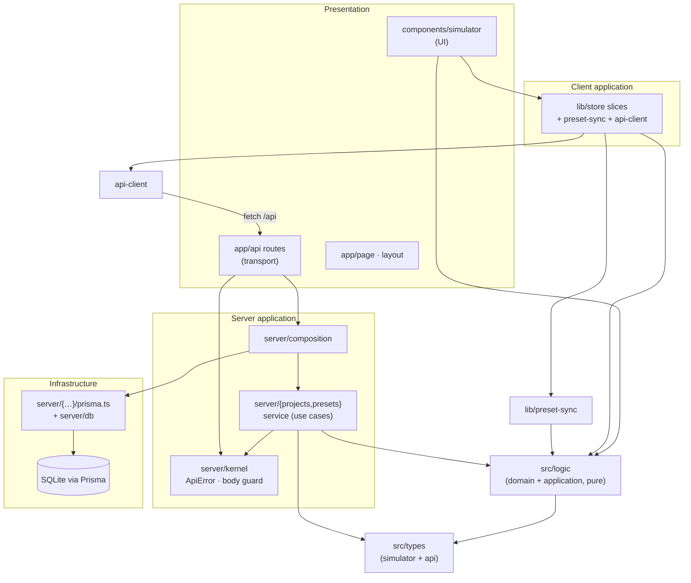

# Architecture

**Repo:** mlger/seg7lab · **Live:** seg7.mlger.dev (Vercel) · **Status:** implemented — this document describes the code as it is.

seg7lab is a modular monolith: one Next.js 16 App Router deployment containing
a pure domain, a server-side application layer, thin HTTP transport, and a
React client. The defining architectural rule predates the refactor and still
governs everything: **one truth table is the single source of truth; every
other view is derived from it by pure functions.**

## Layer map

| Clean-Architecture layer | Where it lives | Rule |
|---|---|---|
| **Domain + Application (pure)** | `src/logic/**` (22 modules) | No React, no DOM, no store, no I/O. Imports only `src/types/simulator` (+ `src/logic/binary`). Enforced mechanically (see [Boundaries](#boundaries)). |
| **Application services + Infrastructure (server)** | `src/server/**` | Use cases own the business rules; persistence behind repository interfaces; Prisma is the only implementation. No React, no client imports. |
| **Transport (HTTP)** | `src/app/api/**` + `src/app/api/_lib/http.ts` | Parse → resolve owner → call service → map `ApiError`/result to `NextResponse`. Never imports Prisma. |
| **Client state + transport** | `src/lib/**` | Zustand store (slices), the preset sync engine, the typed REST client. Imports `src/logic` + `src/types`; never `src/server`. |
| **Presentation (UI)** | `src/components/simulator/**`, `src/app/page.tsx` | Feature-cohesive components; transport lives in `src/lib` hooks; never imports `src/server`. |
| **Shared contract** | `src/types/api.ts` | Wire DTOs used by BOTH server services and the client. |

`src/components/ui/**` is stock shadcn/ui — presentation primitives, out of
scope for custom architecture.

## Directory structure

```text
src/
  logic/                    DOMAIN + APPLICATION — pure, 546+64k checks pin it
    truthTable.ts             truth-table CRUD (the source of truth)
    minimizer.ts              Quine-McCluskey with exact cover + honest budget flag
    kmap.ts, expressions.ts   derived views (K-map groups, 4-notation formatter)
    engine.ts                 orchestrator: table → SegmentEngine per segment
    decoder.ts                runtime lighting rules + default project
    circuitNetlist.ts         gate graph model + evaluator (2-level builders)
    decoderCircuit.ts         full-decoder composition (8 bands, shared rails)
    factoring.ts, factoredDecoderCircuit.ts   multi-level style + cross-segment sharing
    circuitLayout.ts, wireRouting.ts          deterministic layout + SVG wiring
    booleanParser.ts, validation.ts, binary.ts  parser, shared primitives, bit math
    verilogGenerator.ts, circuitverse.ts, falstad.ts   export generators
    standardPatterns.ts, font.ts, presets.ts, project.ts   formats + validation
  server/                   SERVER APPLICATION + INFRASTRUCTURE
    kernel.ts                 ApiError, owner header, body guard, pagination,
                              Prisma-code narrowing — ONE copy, framework-free
    composition.ts            composition root: memoized services + Prisma repos
    db.ts                     Prisma singleton (the only @prisma/client import)
    projects/                 repository.ts (contract) · prisma.ts (adapter) ·
                              service.ts (use cases: visibility, 404→403→409→400
                              precedence, optimistic locking, validation)
    presets/                  same trio, kind-aware blob validation
  app/
    api/_lib/http.ts          ApiError → NextResponse mapping (transport edge)
    api/{projects,presets}/…  thin route handlers (~40–60 lines each)
    page.tsx, layout.tsx, error.tsx, globals.css   app shell
  lib/                       CLIENT STATE + TRANSPORT
    store/                     index (create + engine wiring + attachPersistence),
                              workspace slice, library slice, persistence,
                              pure resolvers, types
    preset-sync.ts            server-sync/conflict engine behind PresetSyncAccess
    api-client.ts             typed REST client returning ApiResult<T>
    use-projects-manager.ts   Projects tab hook (cloud/local fallback + push-up)
    useEngine.ts, colors.ts, client-owner.ts, utils.ts
  components/simulator/      PRESENTATION (feature: the simulator)
    logic-circuit/            CircuitCanvas, GateInspector, controls.tsx
                              (shared toolbar chrome), gateVisuals, GateReference
    truth-table/              table card + memoized rows + toolbar + header
    …(cards per tab), brand/, shared/
  types/
    simulator.ts             domain types (logic-layer contract)
    api.ts                   wire DTOs + ApiResult (shared server/client)
  utils/                    client-side helpers (svg-viewport, exporters, pdf, download)
scripts/                   verification suites (see VERIFICATION.md)
prisma/schema.prisma       SQLite, 2 blob-table models (Project, Preset)
docs/                      this documentation set
```

## Dependency directions (enforced)



Arrows only point toward `src/logic` and `src/types`. The client reaches the
server exclusively through HTTP (`api-client`, `preset-sync`) — never a direct
import of `src/server`.

## Backend request flow

```
Request
  → route handler (src/app/api/.../route.ts)
      parse query/body via kernel (parseJsonBody: 415 → 413 → 400 guard chain)
      ownerFromRequest (x-sevenseg-owner header → string | null)
  → service use case (src/server/<domain>/service.ts)
      business rules: visibility (shared+mine), existence-hiding 404s,
      404→403→409→400 error precedence, optimistic locking,
      field validation + canonicalization (validateProject / preset validators)
      throws ApiError(status, message, errors?, body?) on contract failures
  → repository (src/server/<domain>/prisma.ts)
      Prisma queries; P2002/P2025 bubble up as raw errors
  ← service maps them back to ApiError (409 id-exists / 404 vanished)
  ← route maps ApiError → NextResponse via _lib/http.ts (exact wire envelope)
```

Persistence: two flat tables (`Project`, `Preset`) storing validated JSON
blobs; schema is push-based (`prisma db push`), no migrations. Swapping the
storage engine means writing ONE new repository adapter + a composition change
(see [ADR-0007](./decisions/0007-production-api-defect.md) — the production
Vercel deployment currently cannot use SQLite; that is the pending decision).

## Frontend data flow

```
hydrate() (localStorage workspace → validateProject → state)
   │
   ▼
Zustand store (src/lib/store) — one SimulatorState, two slices
   truthTable ──┬─→ useEngines() ─→ K-map · expressions · circuit netlists
   cover overrides ─┤     (src/lib/useEngine.ts memoizes the whole pipeline;
   variableNames ──┘      input toggles never rebuild the netlist)
   │
   ├─→ persist() on every action (localStorage, debounced subscriber too)
   ├─→ preset-sync engine (best-effort server sync: merge by updatedAt,
   │     optimistic-lock PUTs, 409 reconciliation, push-up of local rows)
   └─→ UI components subscribe with atomic selectors

Projects tab: useProjectsManager (lib) ─→ api-client ─→ /api/projects
              cloud ⇄ local fallback (localStorage) with one-time push-up
```

## Dependency initialization

- **Server:** composition root `src/server/composition.ts` memoizes
  `getProjectService()` / `getPresetService()` bound to the Prisma
  repositories. No DI framework — injection is a function argument
  ([ADR-0002](./decisions/0002-server-service-repository.md)).
- **Client:** `src/lib/store/index.ts` creates the store first, then builds
  the preset-sync engine bound to it (two-phase; the library slice receives
  the engine via a lazy thunk). `page.tsx` calls `hydrate()`,
  `syncPresetsFromServer()`, and `attachPersistence()` on mount.
- **Prisma:** `src/server/db.ts` global singleton (dev HMR-safe); generate
  with `npx prisma generate`.

## Validation, authorization, errors, configuration

- **Validation:** manual validators with E-coded messages (the external
  contract) — request fields in `service.ts`, blobs via `@/logic/project` /
  `@/logic/presets`. The client re-validates everything it reads
  (hydrate, project import, preset sync) so corrupt data never crashes the UI.
- **Authorization:** anonymous per-browser owner token
  (`x-sevenseg-owner` header; client side `src/lib/client-owner.ts`).
  Enforced at the service boundary: foreign rows 404 on reads (existence
  hiding), 403 on writes; `ownerId = null` rows are shared — readable AND
  writable by everyone (documented, intentional). It is a tagging mechanism,
  not authentication.
- **Errors:** internal model is `ApiError` (plain class, framework-free);
  external contract is the `{ error, errors? }` envelope + the 409 conflict
  body — pinned by `scripts/verify-api.mjs`.
- **Configuration:** `DATABASE_URL` (SQLite file, see `.env.example`),
  `NEXT_PUBLIC_SITE_URL` (metadataBase). No other env vars. Server never
  logs blob contents in production (query logging is dev-only).

## Boundaries

Two mechanisms, same rules ([ADR-0006](./decisions/0006-boundary-enforcement.md)):

- `npm run verify:boundaries` — walks every import under `src/`, asserts the
  layer matrix above, plus: no framework packages and no DOM types in
  `src/logic`.
- ESLint `no-restricted-imports` blocks with folder overrides
  (`eslint.config.mjs`) — editor-visible errors for the same violations.

## Extending the application

**Add a field to projects:** 1) extend the blob validator + defaults in
`src/logic/project.ts` (E-code for each rule); 2) nothing in the service
changes (it stores canonical blobs); 3) add the field to
`SimulatorState`/`toProjectData` in `src/lib/store/`; 4) render it in the
card that owns it. The 546-check suite + API characterization protect the
rest.

**Add a REST resource:** copy the `src/server/presets/` trio (repository
interface → Prisma adapter → service), a getter in `composition.ts`, and a
route folder that only imports the service + `api-manager`-style kernel
helpers. Record the contract with `verify-api.mjs --record`.

**Add an export format:** pure generator in `src/logic/` (+ checks in
`verify-logic.ts`), then one menu item in `ExportMenu.tsx` calling it.

**Swap the database (pending decision, see ADR-0007):** write
`turso-repository.ts` implementing the same two interfaces, register it in
`composition.ts`, set `DATABASE_URL` in Vercel, run `prisma migrate`.

## Related documents

- [REFACTOR_PLAN.md](./REFACTOR_PLAN.md) — problems → target → phases
- [REFACTOR_PROGRESS.md](./REFACTOR_PROGRESS.md) — phase status + coverage
- [VERIFICATION.md](./VERIFICATION.md) — executed checks and evidence
- [decisions/](./decisions/) — architecture decision records
- [README.md](../README.md) — developer entry point
